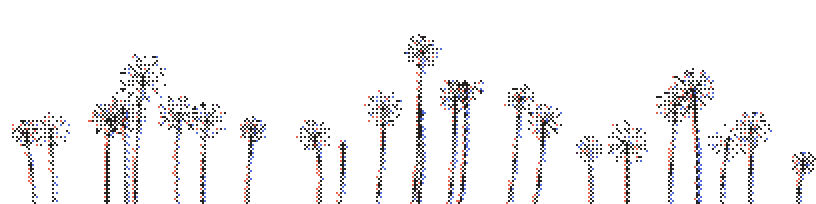

<h1 align="center">Hi, I'm Justin 🐝</h1>
<h3 align="center">
  Computer Science @ the University of Guelph
</h3>

### About
I'm a Computer Science student at the University of Guelph, interested in backend engineering and exploring distributed systems

I like building things to better understand how they work. You can find some of those experiments on my [portfolio](https://justinleski.com/).

### Connect with me

  <!-- Website -->
  <a href="https://justinleski.com">
    <picture>
      <source media="(prefers-color-scheme: dark)"
        srcset="https://img.shields.io/badge/Website-302c28?style=flat-square&labelColor=0e0d0c&logo=googlechrome&logoColor=f6f3ec">
      
    </picture>
  </a>
  <!-- GitHub -->
  <a href="https://github.com/justinleski">
    <picture>
      <source media="(prefers-color-scheme: dark)"
        srcset="https://img.shields.io/badge/GitHub-302c28?style=flat-square&labelColor=0e0d0c&logo=github&logoColor=f6f3ec">
      
    </picture>
  </a>
  <!-- LinkedIn -->
  <a href="https://linkedin.com/in/justinleski">
    <picture>
      <source media="(prefers-color-scheme: dark)"
        srcset="https://img.shields.io/badge/LinkedIn-302c28?style=flat-square&labelColor=0e0d0c&logo=linkedin&logoColor=f6f3ec">
      
    </picture>
  </a>
  <!-- X / Twitter -->
  <a href="https://x.com/justin_leski">
    <picture>
      <source media="(prefers-color-scheme: dark)"
        srcset="https://img.shields.io/badge/X-302c28?style=flat-square&labelColor=0e0d0c&logo=x&logoColor=f6f3ec">
      
    </picture>
  </a>
  <!-- Email -->
  <a href="mailto:sayhello@justinleski.com">
    <picture>
      <source media="(prefers-color-scheme: dark)"
        srcset="https://img.shields.io/badge/Email-302c28?style=flat-square&labelColor=0e0d0c&logo=gmail&logoColor=f6f3ec">
      
    </picture>
  </a>

  <picture>
    <source media="(prefers-color-scheme: dark)" srcset="assets/meadow-dark.png">
    <source media="(prefers-color-scheme: light)" srcset="assets/meadow-light.png">
    
  </picture>

